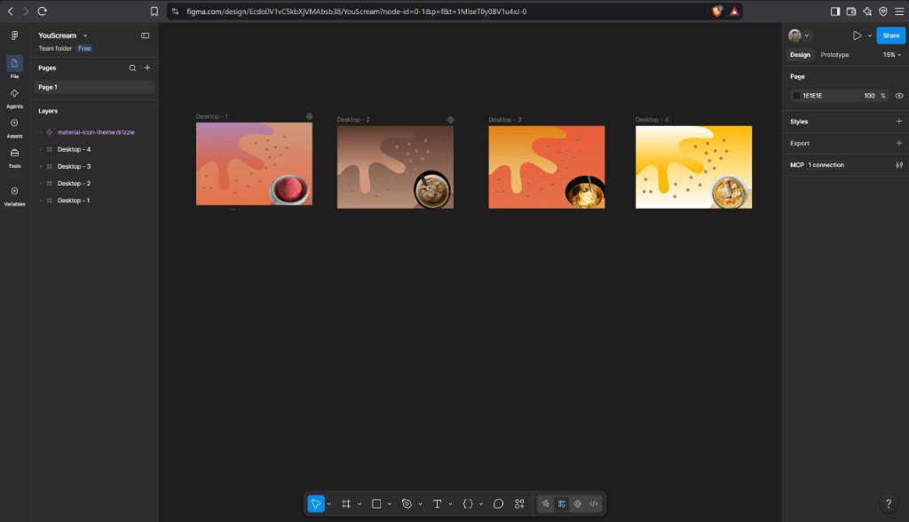
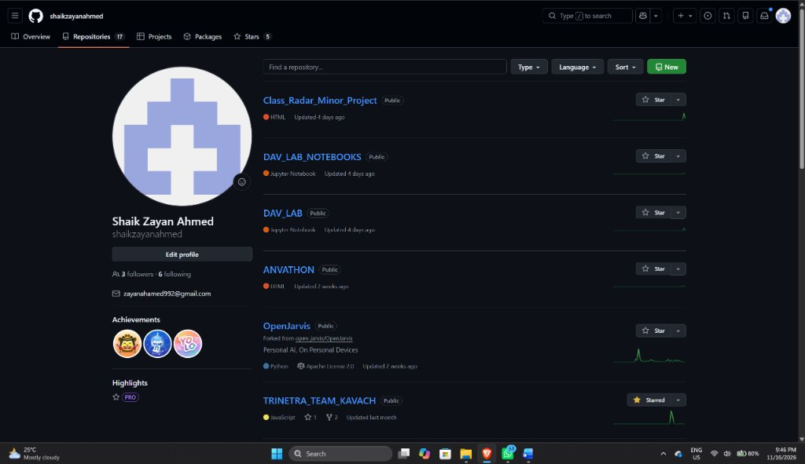
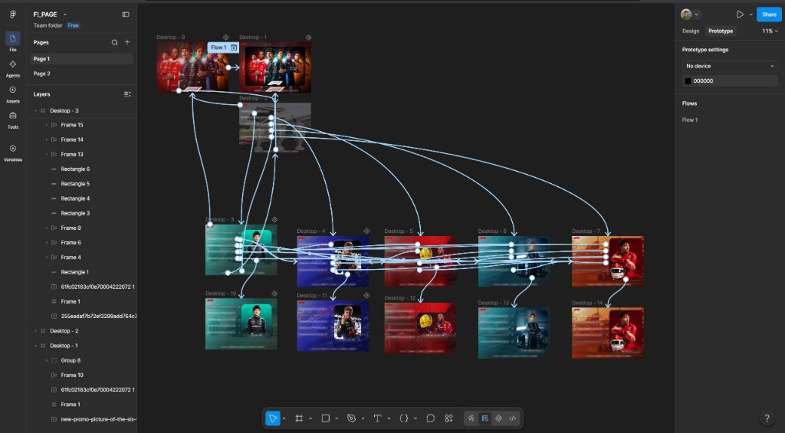
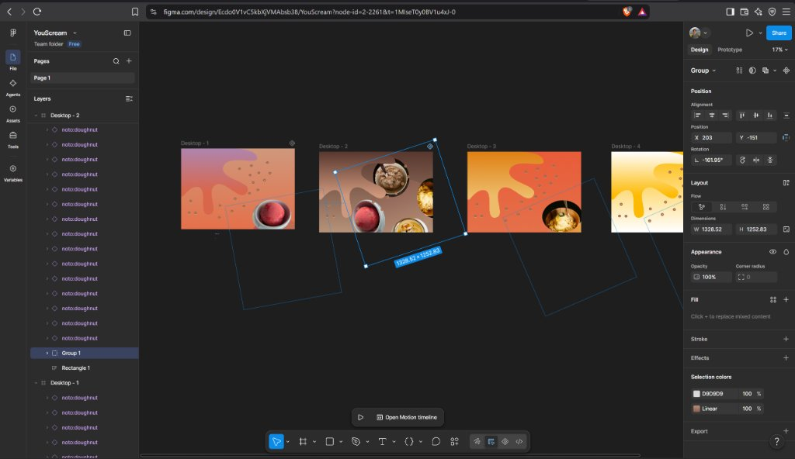
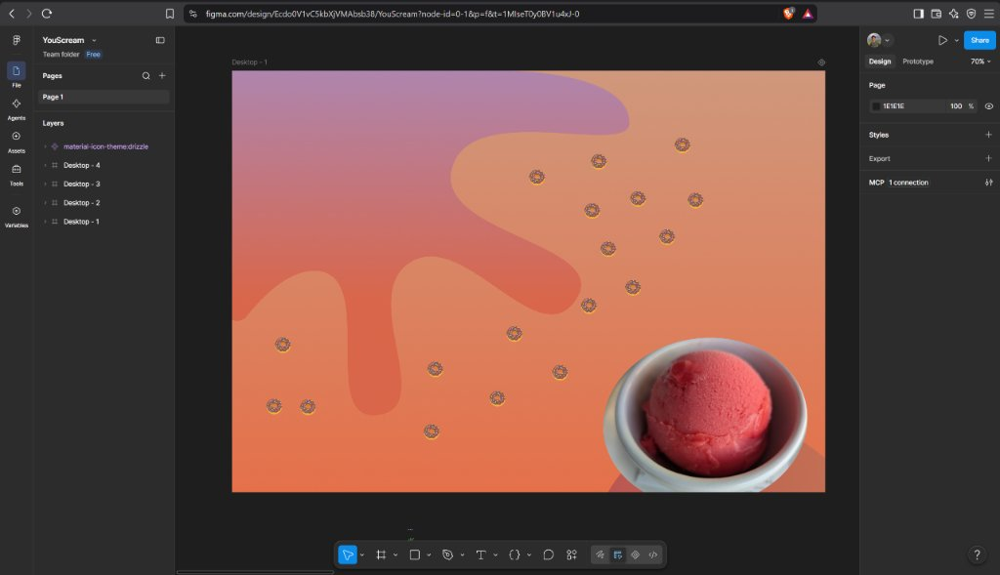
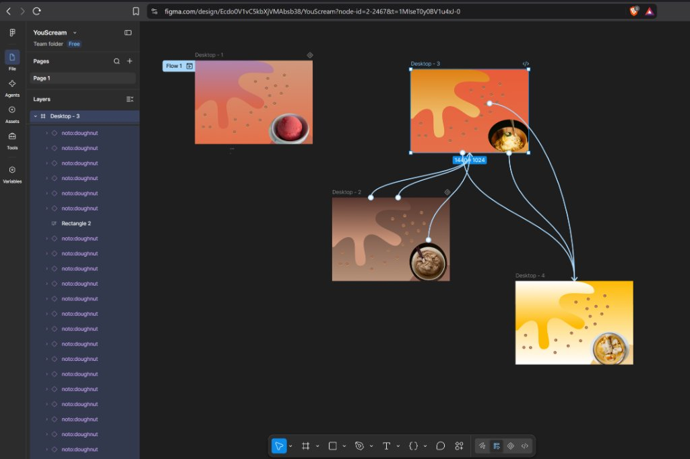

# Experiment 8: Collaborative UI/UX Prototyping Using Figma

**Student Name**: Shaik Zayan Ahmed  
**USN**: 4IK25CS183  
**Course Code**: 1BCS303 - Collaborative Development and DevOps (CDD)  

---

## 1. Project Overview & Design Architecture
This module documents the DesignOps workflow integrated into the modern DevOps lifecycle using Figma. Prototyping interactive wireframes and state machines enables frontend and backend teams to validate specifications, reduce iterations, and automate design token handoffs.

### Project 1: YouScream Interactive Desktop Application
- **Design Mode Canvas**: 4 multi-theme desktop artboards (`Desktop-1` to `Desktop-4`) exploring varied color palettes (cream, mocha, sunset orange, and gold).
- **Prototyping Interaction**: Wires connecting cards, buttons, and dessert product modules using *Smart Animate* and *On Click* transitions.
- **Components & Transformations**: Layer hierarchies, reusable asset tokens, vector splashes, and drizzle effects.

### Project 2: F1 Racing Portal (F1_PAGE)
- **14-Screen Comprehensive Flow**: Complete interactive user navigation architecture connecting motorsport driver cards, livery designs, specifications, and team rosters into a cohesive digital journey.

---

## 2. Design Artifacts & Screenshots

### Figure 8.1: YouScream Multi-Screen Desktop Theme Canvas

### Figure 8.2: YouScream Interactive Prototype Flow Architecture

### Figure 8.3: YouScream Component Grouping and Transformation Controls

### Figure 8.4: YouScream Landing Screen & Vector Drizzle Elements

### Figure 8.5: F1_PAGE 14-Screen Interactive Driver & Team Flow

### Figure 8.6: Shaik Zayan Ahmed - GitHub Developer Profile

